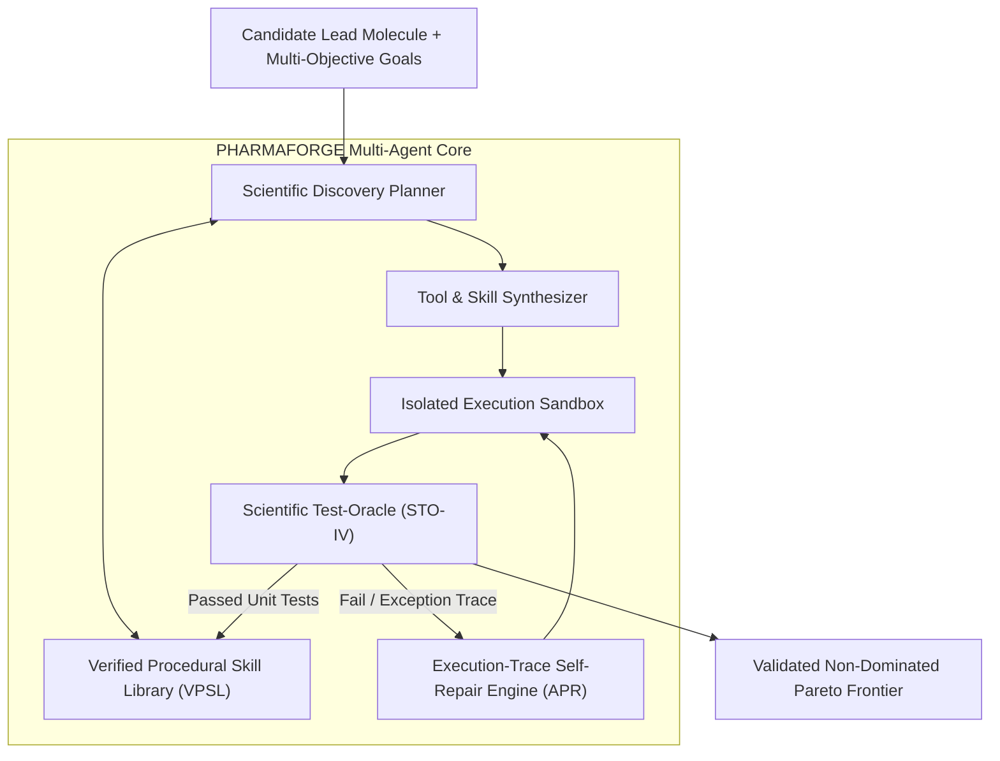

# PHARMAFORGE: A Self-Improving Multi-Agent Framework for Scientific Reasoning and Pharmaceutical Discovery

[](https://www.python.org/downloads/)
[](https://opensource.org/licenses/MIT)
[](https://www.cs.purdue.edu/homes/lintan/)

**Intellectual Synergy:** Aligned with foundational principles in automated program repair (APR), test-driven program synthesis, and dependable agent systems developed by **Professor Lin Tan's ASSET Lab** at Purdue University (*USEagent*, *TENET*, *CoRe*, *CURE*).

---

## 1. Central Research Question

> **Can an AI agent acquire verified, reusable computational skills from previous pharmaceutical optimization tasks and improve its performance on subsequent tasks through execution-feedback-driven self-repair?**

Current scientific LLM agents (such as ChemCrow and Coscientist) suffer from high hallucination rates, lack independent verification, and exhibit **episodic amnesia**—every discovery task starts from scratch, or errors accumulate via unverified prompt reflections. 

**PHARMAFORGE** conceptualizes chemical discovery operations as **executable, testable, and self-repairing computational programs**. Instead of storing natural language text memories, the agent synthesizes parameter-abstracted Python functions, validates them in an AST-inspected sandbox using unit-test oracles, repairs faulty code using execution tracebacks, and preserves verified procedures in a persistent procedural skill library.



---

## 2. Core Architectural Components

1. **Verified Procedural Skill Library (VPSL):** Dynamic, vector-indexed repository of executable, parameterized Python procedures gated by deterministic test harnesses. Unlike unstructured textual memories, procedural skills are software assets that execute in a sandbox and persist across discovery episodes.
2. **Scientific Test-Oracle (STO-IV):** Deterministic verification gate enforcing RDKit chemical sanitization, explicit atomic valence consistency, and PAINS/Brenk toxicophore filters prior to admitting skills or molecules.
3. **Execution-Trace Self-Repair Engine (ET-SRE):** Adapts automated program repair principles (TENET/CURE) to scientific tool execution. Intercepts runtime exception stack traces from the sandbox, diagnoses AST faults (e.g., missing imports or missing guards), and applies iterative patches.
4. **EGFR QSAR Surrogate Model ($M_2$):** Validated Random Forest hybrid model combining 2,048-bit Morgan circular fingerprints and 10 physicochemical descriptors trained on 5,226 core biochemical ChEMBL activity records to guide multi-objective Pareto optimization.

---

## 3. Controlled 4-Way Ablation Study & Empirical Findings

To isolate the impact of persistent memory, verification, and automated program repair, a 4-way ablation was evaluated on historical EGFR kinase leads (`CHEMBL289959` and `CHEMBL290096`):

| Configuration | Skill Memory | Verification Gate | Self-Repair (ET-SRE) | Candidate Validity | Pareto Front | Hypervolume ($\text{HV}_{\text{MC}} \pm \text{SE}$) | Mechanistic Outcome |
|:---|:---:|:---:|:---:|:---:|:---:|:---:|:---|
| **A: Stateless Baseline** | Off | Off | Off | 100.0% (50/50) | 7 | $0.1578 \pm 0.0026$ | Generates clean skills afresh each iteration; zero persistent skill reuse. |
| **B: Unverified Memory** | On | Off | Off | **N/A** (0/0) | 1 | $0.1070 \pm 0.0022$ | **Memory Poisoning:** Buggy skills admitted; repeated crashes across iterations 2–5. |
| **C: Verified (No Repair)** | On | On | Off | **N/A** (0/0) | 1 | $0.1070 \pm 0.0022$ | **Pure Memory, No Recovery:** Failing skills rejected ($\text{Rejections} = 5$), leaving agent tool-less. |
| **D: Full PHARMAFORGE** | On | On | On | **100.0%** (50/50) | **7** | **$0.1578 \pm 0.0026$** | **Self-Repair & Reuse:** Traceback repair fixes fault, re-verifies, enables persistent reuse ($\text{Reuse} = 4$). |

*Values shown for `CHEMBL289959` with $N = 20,000$ Monte Carlo numerical integration samples (seed 42).*

---

## 4. Rigorous Epistemic Distinctions & Scientific Limitations

To maintain uncompromising scientific honesty, PHARMAFORGE adheres to strict epistemic boundaries:

### A. Conceptual Distinctions
- **Experimentally Reported Activity:** Historical wet-lab assay measurements from peer-reviewed publications archived in ChEMBL (e.g., `CHEMBL289959` experimental $\text{IC}_{50} = 344\text{ nM}$, $\text{pChEMBL} = 6.463$; Rewcastle et al., 1996).
- **QSAR-Predicted Activity:** Computational surrogate estimates from our trained Random Forest model ($M_2$). Predicted $p\text{IC}_{50}$ is an in silico ranking proxy, **not** an experimental measurement.
- **Chemical Validity:** Strict structural plausibility established deterministically by RDKit sanitization and valence rules. Validity does not imply biological activity or drug feasibility.
- **Predicted Properties:** Heuristic physicochemical indicators (QED drug-likeness, Wildman-Crippen MolLogP, Ertl SAScore synthesizability).
- **Actual Biological Efficacy:** In vivo or clinical therapeutic effect, which **cannot** be computationally determined and requires prospective wet-lab experimentation.

### B. Explicit Non-Claims & Stated Limitations
1. **Scope of Automated Repair:** ET-SRE was tested on, and is strictly claimed for, **syntactic namespace faults injected during procedural synthesis** (`NameError: name 'Chem' is not defined`). It does not claim arbitrary semantic chemical repair (e.g., correcting reaction SMARTS valence logic or retrosynthetic route design).
2. **Scaffold Representation:** Although `CHEMBL289959` and `CHEMBL290096` were strictly held out from QSAR training, **276 training compounds share their 4-anilinoquinazoline scaffold**. The rediscovery of `CHEMBL290096` ($R = 3-\text{Br}$) is an **in-domain / familiar-scaffold analogue recovery**, not out-of-distribution scaffold generalization.
3. **Configurations A and D Hypervolume Equivalence:** Configs A and D report identical hypervolume ($0.1578$) because clean skills in A perform the same chemical transforms as repaired skills in D. Configuration D demonstrates functional recovery and persistent memory accumulation (`Skill Reuse = 4` vs `0` in A).
4. **LogP Constraint Non-Compliance:** Pyrido-pyrimidine bioisosteres (`Brc1cccc(Nc2ncnc3cnccc23)c1`, $\text{LogP} = 3.531$) lower lipophilicity by $-0.605\log$, but strictly **fail** the stated $\text{LogP} \le 3.500$ constraint by $+0.031\log$. They occupy the Pareto frontier purely via mathematical non-domination across continuous objectives, not constraint satisfaction.
5. **Monte Carlo Numerical Hypervolume:** Multi-objective hypervolume is estimated using Monte Carlo integration ($N = 20,000, \, \text{SE} \approx 0.0026$), not an exact continuous integral.

---

## 5. QSAR Surrogate Model Validation Protocols

Surrogate model $M_2$ (Random Forest Hybrid, 5,226 core biochemical compounds) cross-validation metrics are reported strictly per protocol:

| Protocol | Generalization Regime | $R^2$ Score | Spearman $\rho$ | MAE | RMSE |
|:---|:---|:---:|:---:|:---:|:---:|
| **Random 5-Fold Split** | In-distribution interpolation across chemical space | **0.7050** | **0.8397** | 0.5791 | 0.7737 |
| **Bemis–Murcko Scaffold 5-Fold Split** | Generalization to unseen core molecular scaffolds | **0.5849** | **0.7640** | 0.7074 | 0.9177 |
| **Document Connected-Component 5-Fold Split** | Generalization across independent assay publications | **0.3199** | **0.5816** | 0.9276 | 1.1747 |

*Methodological Rule:* Metrics across different splits evaluate distinct regimes and are never combined or conflated.

---

## 6. Quickstart & Demonstration

Detailed instructions, Windows commands, and live demonstration sequences are provided in [DEMO_GUIDE.md](DEMO_GUIDE.md).

### 1. Launch Interactive Scientific Dashboard
```powershell
python -m streamlit run ui/app.py --server.port 8501
```
Open your browser at `http://localhost:8501`.

### 2. Launch FastAPI Backend
```powershell
python -m uvicorn api.main:app --host 127.0.0.1 --port 8000
```
API Documentation: `http://localhost:8000/docs`.

### 3. Run Automated 7-Step Demonstration Script
```powershell
python scripts/verify_demo_pipeline.py
```

---

## 7. Research Reports & Key Documents

- [DEMO_GUIDE.md](DEMO_GUIDE.md): Live demonstration script, troubleshooting, and navigation guide.
- [data/phase_1_5_final_verification_report.md](data/phase_1_5_final_verification_report.md): Final research integrity audit, numerical consistency reconciliations, and epistemic boundaries.
- [data/phase_1_4_benchmark_optimization_report.md](data/phase_1_4_benchmark_optimization_report.md): Closed-loop multi-objective optimization report and 4-way ablation records.
- [artifacts/benchmark_runs/benchmark_optimization_results.json](artifacts/benchmark_runs/benchmark_optimization_results.json): Full machine-readable ablation run data and Monte Carlo hypervolume records.

---

## 8. License & Disclaimer

Distributed under the MIT License. All predictions and generated procedures are experimental computational artifacts for research purposes only. Computational predictions do not constitute biological confirmation or medical advice.
