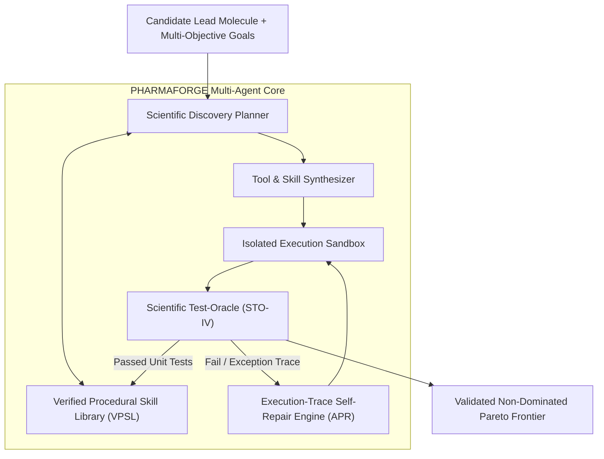

# PHARMAFORGE

### A Self-Improving Framework for Procedural Learning and Pharmaceutical Optimization

PHARMAFORGE is an experimental research prototype investigating how AI agents can acquire reusable computational skills, validate generated procedures, and recover from execution failures during multi-objective molecular optimization.

The framework combines a persistent procedural skill library, deterministic cheminformatics verification, execution-feedback-driven repair, and QSAR-based molecular property prediction.

Its central research question is:

**Can an AI agent learn verified, reusable computational procedures from previous optimization tasks and apply them to subsequent tasks through execution feedback and self-repair?**

PHARMAFORGE explores this question through an EGFR-focused molecular optimization benchmark, controlled ablation experiments, and computational evaluation.

*This is an in-silico research prototype. Predicted molecular properties and activity scores are not experimental evidence of biological efficacy.*

[](https://www.python.org/downloads/)
[](https://opensource.org/licenses/MIT)
[](https://www.docker.com/)
[](tests/)

---

## 1. Problem Statement

Current generative language model agents applied to scientific discovery suffer from two structural limitations:
1. **Episodic Amnesia:** Discovery tasks operate in isolation. The agent cannot accumulate verified, reusable procedural capabilities across successive optimization episodes.
2. **Unverified Textual Reflection:** When tool or synthesis errors occur, conventional agents rely on unstructured natural language prompts to reflect on mistakes. This frequently compounds errors without validating whether the underlying chemical code or reaction mechanism is syntactically sound, chemically valid, or reproducible.

---

## 2. Proposed Approach

PHARMAFORGE formalizes molecular optimization operations as **executable, testable, and self-repairing computational programs**. Instead of storing natural language text memories, the agent:
- Synthesizes parameter-abstracted Python transformation functions.
- Validates code in an AST-inspected execution sandbox using deterministic chemoinformatics unit tests.
- Diagnoses runtime exceptions from execution tracebacks and repairs faulty code.
- Preserves verified procedures in a persistent procedural skill library for retrieval in subsequent optimization episodes.

---

## 3. Architecture



---

## 4. Core Components

1. **Verified Procedural Skill Library (VPSL):** A vector-indexed repository of executable, parameterized Python procedures gated by deterministic test harnesses. Unlike unstructured text reflections, procedural skills are executable software assets that persist across discovery episodes.
2. **Scientific Test-Oracle (STO-IV):** A deterministic verification gate enforcing RDKit chemical sanitization, explicit atomic valence consistency, and PAINS/Brenk toxicophore filters prior to admitting skills or proposed molecules.
3. **Execution-Trace Self-Repair Engine (ET-SRE):** Adapts automated program repair principles (drawing from program repair literature including CURE and TENET) to scientific tool execution. Intercepts runtime exception stack traces from the sandbox, diagnoses AST faults (e.g., missing imports or missing guards), and applies iterative patches.
4. **EGFR QSAR Surrogate Model ($M_2$):** A Random Forest hybrid model combining 2,048-bit Morgan circular fingerprints and 10 physicochemical descriptors trained on 5,226 core biochemical ChEMBL activity records to guide multi-objective Pareto optimization.

---

## 5. Experimental Evaluation

Surrogate model $M_2$ (Random Forest Hybrid, 5,226 core biochemical compounds) cross-validation metrics were evaluated under strict leakage-safe protocols:

| Protocol | Generalization Regime | $R^2$ Score | Spearman $\rho$ | MAE ($\log$ units) | RMSE ($\log$ units) |
|:---|:---|:---:|:---:|:---:|:---:|
| **Random 5-Fold Split** | In-distribution interpolation across chemical space | **0.7050** | **0.8397** | 0.5791 | 0.7737 |
| **Bemis–Murcko Scaffold 5-Fold Split** | Generalization to unseen core molecular scaffolds | **0.5849** | **0.7640** | 0.7074 | 0.9177 |
| **Document Connected-Component 5-Fold Split** | Generalization across independent assay publications | **0.3199** | **0.5816** | 0.9276 | 1.1747 |

*Methodological Rule:* Metrics across different splits evaluate distinct regimes and are never conflated.

---

## 6. Results & Limitations

### Controlled 4-Way Ablation Study
To isolate the impact of persistent memory, verification, and automated program repair, a 4-way ablation was evaluated on historical EGFR kinase leads (`CHEMBL289959` and `CHEMBL290096`):

| Configuration | Skill Memory | Verification Gate | Self-Repair (ET-SRE) | Candidate Validity | Pareto Front | Hypervolume ($\text{HV}_{\text{MC}} \pm \text{SE}$) | Mechanistic Outcome |
|:---|:---:|:---:|:---:|:---:|:---:|:---:|:---|
| **A: Stateless Baseline** | Off | Off | Off | 100.0% (50/50) | 7 | $0.1578 \pm 0.0026$ | Generates clean skills afresh each iteration; zero persistent skill reuse. |
| **B: Unverified Memory** | On | Off | Off | **N/A** (0/0) | 1 | $0.1070 \pm 0.0022$ | **Memory Poisoning:** Buggy skills admitted; repeated crashes across iterations 2–5. |
| **C: Verified (No Repair)** | On | On | Off | **N/A** (0/0) | 1 | $0.1070 \pm 0.0022$ | **Pure Memory, No Recovery:** Failing skills rejected ($\text{Rejections} = 5$), leaving agent tool-less. |
| **D: Full PHARMAFORGE** | On | On | On | **100.0%** (50/50) | **7** | **$0.1578 \pm 0.0026$** | **Self-Repair & Reuse:** Traceback repair fixes fault, re-verifies, enables persistent reuse ($\text{Reuse} = 4$). |

*Values shown for `CHEMBL289959` with $N = 20,000$ Monte Carlo numerical integration samples (seed 42).*

### Epistemic Boundaries & Scientific Limitations
1. **Scope of Automated Repair:** ET-SRE was evaluated on syntactic namespace faults injected during procedural synthesis (`NameError: name 'Chem' is not defined`). It does not claim arbitrary semantic chemical repair (e.g., reaction mechanism design).
2. **Scaffold Context:** Although benchmark leads (`CHEMBL289959`, `CHEMBL290096`) were strictly held out from QSAR training, 276 training compounds share their 4-anilinoquinazoline core. Rediscovery of `CHEMBL290096` ($R = 3-\text{Br}$) represents an **in-domain / familiar-scaffold analogue recovery**, not zero-shot out-of-distribution scaffold generalization.
3. **Configurations A and D Equivalence:** Configs A and D report identical hypervolume ($0.1578$) because clean skills in A perform the same chemical transforms as repaired skills in D. Configuration D demonstrates functional recovery and persistent memory accumulation (`Skill Reuse = 4` vs `0` in A).
4. **LogP Constraint Compliance:** Pyrido-pyrimidine bioisosteres (`Brc1cccc(Nc2ncnc3cnccc23)c1`, $\text{LogP} = 3.531$) lower lipophilicity by $-0.605\log$, but strictly fail the $\text{LogP} \le 3.500$ constraint threshold by $+0.031\log$. They occupy the Pareto frontier via mathematical non-domination across continuous objectives, not constraint satisfaction.
5. **Monte Carlo Numerical Hypervolume:** Multi-objective hypervolume is estimated using Monte Carlo integration ($N = 20,000, \, \text{SE} \approx 0.0026$).

---

## 7. Installation & Demonstration

The primary deployment method uses Docker Compose, providing a self-contained runtime with pre-trained models and benchmark artifacts.

### Option A: Docker Compose Deployment (Recommended)

**Prerequisite:** Ensure [Docker Desktop](https://www.docker.com/products/docker-desktop/) is installed and running.

```bash
# 1. Clone and navigate to the repository
git clone https://github.com/SravyaMummana2006/PHARMAFORGE.git
cd PHARMAFORGE

# 2. Build and launch services in detached mode
docker compose up --build -d
```

Once running:
- **Streamlit Scientific Dashboard:** [http://localhost:8501](http://localhost:8501)
- **FastAPI Backend & Health:** [http://localhost:8000/health](http://localhost:8000/health)
- **Interactive OpenAPI Documentation:** [http://localhost:8000/docs](http://localhost:8000/docs)

For subsequent starts using the already-built image without rebuilding:
```bash
docker compose up -d
```

To stop services:
```bash
docker compose down
```

---

### Option B: Native Python Setup (Development Alternative)

For local development without Docker:

```powershell
# 1. Create and activate a virtual environment
python -m venv venv
.\venv\Scripts\Activate.ps1

# 2. Install dependencies in editable mode
pip install -r requirements.txt
pip install -e .

# 3. Launch the FastAPI backend
python -m uvicorn api.main:app --host 127.0.0.1 --port 8000

# 4. Launch the Streamlit dashboard (in a separate terminal)
python -m streamlit run ui/app.py --server.port 8501
```

---

### Option C: Automated Demonstration Script
```powershell
python scripts/verify_demo_pipeline.py
```

---

## 8. Repository Structure & Key Documents

- [DEMO_GUIDE.md](DEMO_GUIDE.md): Live demonstration workflow, step-by-step verification, and troubleshooting guide.
- [data/phase_1_5_final_verification_report.md](data/phase_1_5_final_verification_report.md): Research integrity audit, numerical consistency reconciliations, and epistemic boundaries.
- [data/phase_1_4_benchmark_optimization_report.md](data/phase_1_4_benchmark_optimization_report.md): Closed-loop multi-objective optimization report and ablation records.
- [artifacts/benchmark_runs/benchmark_optimization_results.json](artifacts/benchmark_runs/benchmark_optimization_results.json): Machine-readable ablation run data and Monte Carlo hypervolume records.

---

## 9. License & Research Disclaimer

Distributed under the MIT License. All predictions and generated procedures are experimental computational artifacts for research purposes only. Computational predictions do not constitute biological confirmation, therapeutic claims, or medical advice.
